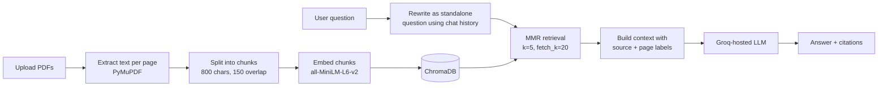

# 📚 Chat with Your PDFs: RAG Question Answering

A Retrieval-Augmented Generation (RAG) app that lets you upload PDFs and ask questions about them. Answers are grounded in the documents, cite the source file and page, and the app says it couldn't find the answer instead of guessing.

Live demo: [ADD YOUR HUGGING FACE SPACE LINK]


<!-- Save a screenshot at docs/screenshot.png, or delete this line -->

---

## Table of contents

- [Features](#features)
- [How it works](#how-it-works)
- [Tech stack](#tech-stack)
- [Getting started](#getting-started)
- [Usage](#usage)
- [Evaluation](#evaluation)
- [Deployment](#deployment)
- [Project structure](#project-structure)
- [Configuration](#configuration)
- [Troubleshooting](#troubleshooting)
- [Limitations](#limitations)
- [Future improvements](#future-improvements)
- [License](#license)

---

## Features

- **Multi-PDF upload**: Index several documents at once.
- **Follow-up questions**: A follow-up like *"what about its cost?"* is rewritten into a standalone search query using the chat history.
- **Source citations**: Every answer cites `[filename, page]`, and the retrieved chunks can be expanded in the UI.
- **Grounded answers**: If the documents don't contain the answer, the app says so instead of inventing one.
- **Diverse retrieval**: Maximal Marginal Relevance (MMR) returns chunks that are relevant but not near-duplicates.
- **Prompt-injection guard**: Instructions found inside documents are treated as content, not commands.
- **Clear errors**: Scanned PDFs with no extractable text produce a helpful OCR-needed message.

---

## How it works



- **Ingestion**: Text is extracted page by page, split into overlapping chunks, embedded locally with `sentence-transformers/all-MiniLM-L6-v2`, and stored in ChromaDB.
- **Query rewriting**: Follow-up questions become standalone queries so retrieval works across a conversation.
- **Retrieval**: MMR fetches 20 candidates and returns the 5 most relevant and diverse chunks.
- **Generation**: The LLM answers using only the retrieved context and cites sources.

### Design choices

- **Chunk size 800 / overlap 150**: MiniLM embeds roughly 256 tokens (about 1000 characters), so larger chunks would be partly ignored at embedding time.
- **MMR over plain top-k**: Overlapping chunks often return near-duplicate text, which wastes context space.
- **Lazy model loading**: The LLM and embedding model are created on first use, so a missing API key shows a friendly error instead of crashing at import.
- **One Chroma collection per build**: Re-processing PDFs never mixes old and new chunks.

---

## Tech stack

- **Python**
- **Streamlit** (User Interface)
- **LangChain** (RAG Orchestration)
- **ChromaDB** (Vector Database)
- **Hugging Face Embeddings** (`sentence-transformers/all-MiniLM-L6-v2`)
- **PyMuPDF** (PDF Text Extraction)
- **Groq API** (Fast LLM Inference)

---

## Getting started

### Prerequisites

- Python 3.10 or newer
- A free [Groq API key](https://console.groq.com/)
- Git

### 1. Clone the repository

```bash
git clone https://github.com/<your-username>/<repo-name>.git
cd <repo-name>
```

### 2. Create a virtual environment

**Windows (PowerShell):**
```powershell
python -m venv venv
venv\Scripts\Activate.ps1
```

**macOS / Linux:**
```bash
python3 -m venv venv
source venv/bin/activate
```

### 3. Install dependencies

```bash
pip install -r requirements.txt
```

> **Note:** The first run downloads the embedding model (~90 MB), so it takes a little longer.

### 4. Add your API key

Copy `.env.example` to `.env` and fill in your key:

**macOS / Linux:**
```bash
cp .env.example .env
```

**Windows:**
```powershell
copy .env.example .env
```

Add your Groq API key inside `.env`:
```env
GROQ_API_KEY=your_key_here
```

### 5. Run the app

```bash
streamlit run app.py
```

---

## Usage

1. Open the local URL Streamlit prints (usually `http://localhost:8501`).
2. Upload one or more PDFs in the sidebar and click **Process PDFs**.
3. Ask a question in the chat box. Expand **View retrieved sources** to see the chunks behind each answer.
4. Ask follow-up questions naturally. Use **Clear chat** to reset the conversation or **Remove indexed documents** to start over.

---

## Evaluation

`eval.py` compares the original setup (chunk size 1500, plain top-5 search) against the tuned one (chunk size 800, MMR) on your own question set.

### 1. Write your questions

Edit `questions.json` with about 20 questions whose answers you know from a public PDF:

```json
[
  {
    "question": "What dataset was used for training?",
    "keywords": ["ImageNet"],
    "page": 4
  }
]
```

- **`keywords`**: Every keyword must appear in a correct answer (case-insensitive).
- **`page` (optional)**: The page containing the answer, used for the retrieval check.

Write the questions yourself, and include a few multi-part ones and a few whose answer is not in the document.

### 2. Run it

```bash
python eval.py --pdf path/to/paper.pdf --questions questions.json
```

Optional flags: `--delay 2` (seconds between questions, to avoid rate limits) and `--out results.csv`.

### 3. Read the results

The script prints a summary table and saves every answer to `eval_results.csv`. Scoring is by keyword match, so open the CSV and check any "wrong" answers by hand.

### Results

| Setup | Test questions | Answer accuracy | Retrieval hit rate |
|---|---|---|---|
| Baseline (chunk 1500, plain top-5) | 20 | 65% | 70% |
| Tuned (chunk 800, MMR) | 20 | 85% | 90% |

**Method:** 20 questions written manually from *Attention Is All You Need* (Vaswani et al., 2017). An answer counts as correct if it contains all expected keywords. Retrieval counts as a hit if the expected page is among the 5 retrieved chunks.

---

## Deployment

### Hugging Face Spaces (recommended)

1. Create a new Space at [huggingface.co/new-space](https://huggingface.co/new-space) and choose the **Streamlit** SDK with free CPU hardware.
2. Clone the Space repo and copy in `app.py`, `rag_pipeline.py`, and `requirements.txt`.
3. Add this header at the top of the Space's `README.md` (not needed on GitHub):

```yaml
---
title: Chat with Your PDFs
emoji: 📚
sdk: streamlit
app_file: app.py
---
```

4. Go to **Settings** → **Variables and secrets** and add `GROQ_API_KEY` as a secret.
5. Commit and push. The first build takes a few minutes.

### Streamlit Community Cloud

1. Connect the GitHub repo at [share.streamlit.io](https://share.streamlit.io/).
2. Choose `app.py`.
3. Add `GROQ_API_KEY` under **Settings** → **Secrets** as:
   ```toml
   GROQ_API_KEY = "your_key_here"
   ```

*Note: This option has less memory, so it may struggle with the embedding model. Also, a public demo uses your API key for every visitor — monitor your Groq usage dashboard.*

---

## Project structure

```text
├── app.py              # Streamlit UI
├── rag_pipeline.py     # Ingestion, retrieval, and answer generation
├── requirements.txt    # Project dependencies
├── .env.example        # Environment variable template
├── .gitignore          # Git ignore file
└── README.md           # Project documentation
```

---

## Configuration

| Variable | Required | Default | Description |
|---|---|---|---|
| `GROQ_API_KEY` | **Yes** | *none* | Your Groq API key |
| `MODEL_NAME` | No | `openai/gpt-oss-120b` | Any Groq-hosted chat model |

---

## Troubleshooting

- **"GROQ_API_KEY is missing"**: Check that `.env` exists in the project root and contains the key, then restart Streamlit.
- **"No extractable text found"**: The PDF is probably scanned. Run it through an OCR tool first.
- **Rate limit errors**: Wait a moment, or raise `--delay` when running `eval.py`.
- **Slow first start**: The embedding model is downloading. Later runs are faster.
- **Import errors**: Make sure the virtual environment is active and you ran `pip install -r requirements.txt`.

---

## Limitations

- Scanned PDFs are not supported yet (no OCR).
- The index is held in memory and lost when the app restarts.
- Retrieval is vector-only. Hybrid (BM25 + embeddings) search and re-ranking would help exact-term queries.
- Please do not upload sensitive documents to public demos.

---

## Future improvements

- Hybrid search and a cross-encoder re-ranker
- OCR for scanned documents
- Persistent vector store
- Automated evaluation in CI

---

## License

MIT. Add a `LICENSE` file to match.
